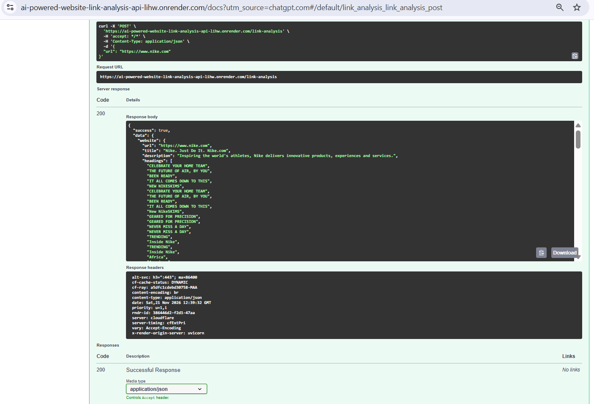
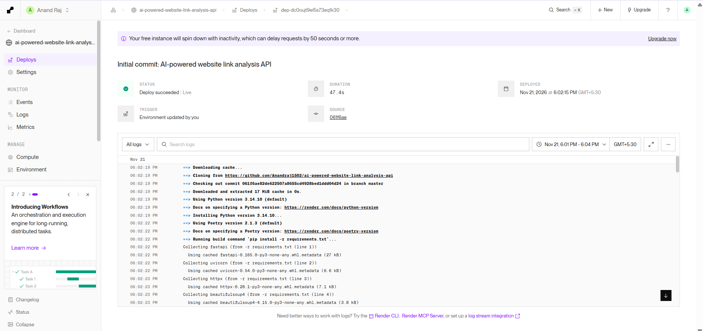
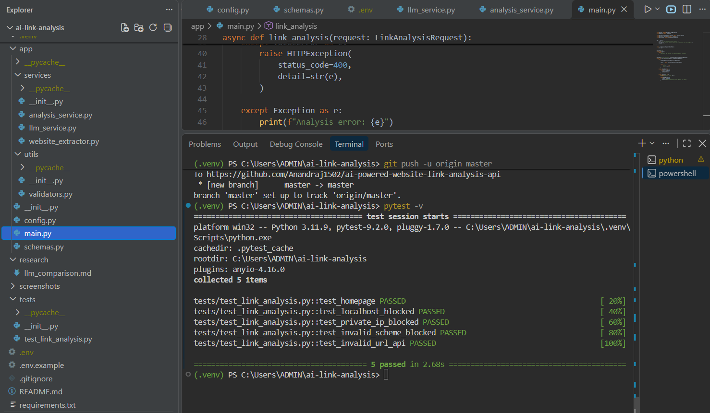

# AI-Powered Website Link Analysis API

An AI-powered REST API that extracts website content and generates business insights, competitor analysis, target audience insights, search query suggestions, and SEO recommendations using Google Gemini and FastAPI.

## Live Demo

- **Live API:** https://ai-powered-website-link-analysis-api-lihw.onrender.com
- **Interactive API Documentation (Swagger):** https://ai-powered-website-link-analysis-api-lihw.onrender.com/docs
- **GitHub Repository:** https://github.com/Anandraj1502/ai-powered-website-link-analysis-api

> The API is deployed on Render's free instance. The service may spin down after inactivity, so the first request can take longer to respond.

## Overview

This project analyzes a website URL by extracting its publicly accessible page content and passing the extracted information to Google Gemini for structured AI analysis.

It is designed to help users understand a website's business, marketing position, potential audience, competitors, and SEO opportunities without manually reviewing the entire website.

## Features

- Website content extraction using HTTPX and BeautifulSoup
- AI-powered business analysis using Google Gemini
- Business overview and brand positioning
- Target audience identification
- Strengths, weaknesses, and market gap analysis
- AI-inferred competitor identification
- Exactly 5 suggested search queries
- Search intent and target audience for each query
- SEO title and meta description suggestions
- Keyword recommendations
- Content improvement suggestions
- Top 5 service suggestions
- Structured JSON API response
- FastAPI REST API
- Interactive Swagger documentation
- URL validation
- Blocking localhost and private IP targets
- Redirect validation
- Website response size limit
- Automated testing using Pytest

## Tech Stack

- **Language:** Python 3.11
- **API Framework:** FastAPI
- **Server:** Uvicorn
- **Website Fetching:** HTTPX
- **HTML Parsing:** BeautifulSoup4
- **Data Validation:** Pydantic
- **AI Model:** Google Gemini
- **AI SDK:** Google GenAI
- **Configuration:** python-dotenv
- **Testing:** Pytest
- **Deployment:** Render
- **Version Control:** Git & GitHub

## Project Structure

```text
ai-link-analysis/
│
├── app/
│   ├── __init__.py
│   ├── main.py
│   ├── config.py
│   ├── schemas.py
│   │
│   ├── services/
│   │   ├── __init__.py
│   │   ├── website_extractor.py
│   │   ├── llm_service.py
│   │   └── analysis_service.py
│   │
│   └── utils/
│       ├── __init__.py
│       └── validators.py
│
├── tests/
│   ├── __init__.py
│   └── test_link_analysis.py
│
├── research/
│   └── llm_comparison.md
│
├── screenshots/
│   ├── render_live_api_test.png
│   ├── render_deployment_success.png
│   └── pytest_all_tests_passed.png
│
├── .env
├── .env.example
├── .gitignore
├── requirements.txt
└── README.md
```

## Setup and Installation

### 1. Clone the Repository

```bash
git clone https://github.com/Anandraj1502/ai-powered-website-link-analysis-api.git
cd ai-powered-website-link-analysis-api
```

### 2. Create a Virtual Environment

```bash
python -m venv .venv
```

### 3. Activate the Virtual Environment

**Windows PowerShell:**

```powershell
.venv\Scripts\Activate.ps1
```

### 4. Install Dependencies

```bash
python -m pip install -r requirements.txt
```

### 5. Configure Environment Variables

Create a `.env` file in the root project directory.

```env
GEMINI_API_KEY=your_gemini_api_key
GEMINI_MODEL=your_supported_gemini_model
```

Replace the placeholder values with your own configuration.

**Important:** Never commit your real API key to GitHub.

### 6. Run the API

```bash
python -m uvicorn app.main:app --host 127.0.0.1 --port 4000 --reload
```

The API will be available locally at:

http://127.0.0.1:4000

## API Usage

### Endpoint

`POST /link-analysis`

### Request Body

```json
{
  "url": "https://example.com"
}
```

### cURL Example

```bash
curl -X POST "http://127.0.0.1:4000/link-analysis" \
  -H "Content-Type: application/json" \
  -d "{\"url\":\"https://example.com\"}"
```

### Successful Response

```json
{
  "success": true,
  "data": {
    "website": {
      "url": "https://example.com",
      "title": "Example Domain",
      "description": "",
      "headings": [],
      "content": "Extracted website content",
      "content_length": 171
    },
    "analysis": {
      "business_overview": "Business summary",
      "brand_positioning": "Brand positioning analysis",
      "target_audience": "Target audience description",
      "strengths": [],
      "weaknesses": [],
      "market_gaps": [],
      "competitors": [],
      "top_5_search_queries": [],
      "seo_recommendations": {
        "recommended_title": "SEO title suggestion",
        "meta_description": "Meta description suggestion",
        "keywords": [],
        "content_suggestions": []
      },
      "top_5_services": []
    }
  }
}
```

## API Documentation

FastAPI automatically generates interactive API documentation.

Once the server is running, open:

- Swagger UI: http://127.0.0.1:4000/docs
- ReDoc: http://127.0.0.1:4000/redoc

You can test the `POST /link-analysis` endpoint directly through Swagger UI.

## Testing

Automated tests are implemented using Pytest.

Run tests:

```bash
pytest -v
```

### Test Coverage

The current test suite includes:

- Homepage endpoint
- Localhost URL blocking
- Private IP address blocking
- Invalid URL scheme blocking
- Invalid URL API request handling

### Test Results

**5 tests passed**

The test suite verifies core API functionality and URL validation behavior.

## Deployment

The API is deployed using Render.

**Production URL:**

https://ai-powered-website-link-analysis-api-lihw.onrender.com

**Production API Documentation:**

https://ai-powered-website-link-analysis-api-lihw.onrender.com/docs

The application is configured to run using Uvicorn on Render's assigned port.

## Security Considerations

The project includes basic security measures to reduce risks when processing user-provided URLs:

- Rejects localhost and private IP targets
- Validates URL schemes
- Validates redirects
- Limits the amount of webpage content processed
- Uses request timeouts
- Accepts HTML content for extraction

These protections reduce common risks associated with fetching arbitrary URLs. However, the implementation is not a complete production-grade SSRF defense and may still require additional protections such as DNS pinning, outbound network restrictions, and stronger infrastructure-level validation.

## AI Analysis Disclaimer

The generated business insights, competitor suggestions, market gaps, search queries, and SEO recommendations are AI-generated and should be treated as suggestions rather than verified market research.

Competitors are inferred by the AI and are not independently verified through live market data. Search volume, rankings, and other quantitative SEO metrics are not represented as verified data.

## Screenshots

### Live API Test

Successful request to the deployed API with a JSON response.



### Render Deployment

Successful deployment status on Render.



### Automated Tests

Pytest results showing all five tests passing.



## Research

LLM model comparison research is available in:

[`research/llm_comparison.md`](research/llm_comparison.md)

The research evaluates different LLM options based on cost, speed, quality, context window, structured output capabilities, and suitability for this project.

## Future Improvements

- Add support for additional LLM providers
- Implement automatic fallback between models
- Improve DNS rebinding protection
- Add deeper multi-page website crawling
- Add persistent analysis history
- Add rate limiting and caching
- Improve structured competitor validation
- Add more automated tests
- Add monitoring and logging

## Author

**Anand Raj**

GitHub: https://github.com/Anandraj1502

---

*Built as a practical AI-powered website analysis project combining web extraction, LLM-based insights, API development, testing, and cloud deployment.*
